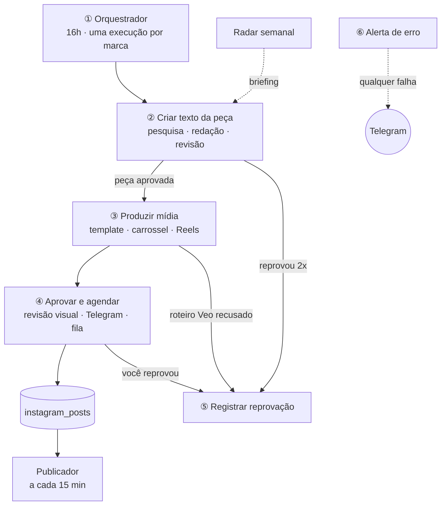

# Instagram automático: Tábua, Puka e ezf.tech (n8n)

São **3 workflows**, cada um com notas de cabeçalho (*o que faz / o que entra / o que sai*) e faixas coloridas separando as fases:

| Arquivo | Workflow | Quando roda | Para que serve |
|---|---|---|---|
| `fluxo/01-producao.json` | **Produção de posts** | todo dia 16h (ou botões de teste) | decide o que cada marca posta amanhã, escreve, revisa, gera a mídia, pede a sua aprovação no Telegram e grava na fila |
| `fluxo/02-publicador.json` | **Publicador no Instagram** | a cada 15 min | pega o próximo post da fila na hora certa e publica (imagem, carrossel ou Reels) |
| `fluxo/03-radar.json` | **Radar semanal** (opcional) | segunda 7h | pesquisa concorrentes, hashtags e a web e guarda um briefing de ideias |

> **Estado:** conferido por script (conexões, referências entre nós, sintaxe dos nós de código, caminhos com dados simulados), mas **ainda não importado numa instância n8n real**.

## O mapa da Produção (de cima para baixo no canvas)



O workflow de Produção **chama a si mesmo uma vez por marca** (nó *Produzir peça de cada marca* → gatilho *Início: produzir post*). Assim a aprovação de uma marca no Telegram não trava a outra, e você **não precisa ligar workflows entre si**.

## A "peça": o objeto que passa de uma seção para outra

Criado no fim da seção ② (nó *Consolidar post aprovado*):

`marca` (objeto com nome, regras, `geral`…) · `tipo` · `motor` · `rota` · `modelo` · `pilar` · `tema` · `legenda` · `alt_text` · `dados_render` · `dados_render_json` · `prompt_imagem` · `prompt_veo` · `cenas_texto` · `fontes_usadas` · `nota_revisao` · `observacoes_revisao` · `reescrito` · `veo_no_mes` · `arquivo` · `pasta` · `midia_url`

A seção ③ acrescenta `midia_urls` (lista de lâminas), `veo_gerado` e `veo_ok`. A ④ grava na fila e o Publicador só lê a tabela.

## Primeira importação

1. **Tabelas (Data Tables):** `instagram_posts` (marca, tipo, modelo, motor, pilar, tema, legenda, midia_url, **midia_urls**, fontes, status, ig_user_id, ig_media_id, erro, nota_revisao, agendado_para; `midia_urls` guarda a lista de lâminas do carrossel em JSON) e `instagram_referencias` (marca, semana, briefing, erros, urls_validas, posts_analisados).
2. **Importe cada arquivo como um workflow separado:** Workflows → *Create workflow* → menu **⋯** → **Import from File**. Um arquivo por workflow; **nunca cole o conteúdo de um arquivo dentro de outro workflow**.
3. **Configuração única:** no workflow de **Produção**, nó **Marcas e regras**, troque os `PREENCHER` (chat do Telegram, bucket, URL pública, ids do Instagram). `render_url` é o endereço do serviço de render na sua VM (com n8n em Docker, o gateway da rede do container). No **Publicador**, troque o chat em **Avisar resultado**; na Produção, o chat do **Avisar erro no Telegram** (seção ⑥).
4. **Credenciais** (escolha em cada nó): Gemini (texto, e o mesmo serve para imagem e vídeo; também faz a busca na web) · Telegram · S3/R2 · Header Auth do render (`Authorization: Bearer …`) · Meta Graph API. Nos nós de modelo do Gemini (os 5 "Gemini …" do canvas), escolha também o **modelo**.
5. **Fuso:** cada workflow → Configurações → **America/Sao_Paulo**.
6. **Error workflow:** nos 3 workflows → Configurações → **Error workflow** → escolha o workflow de **Produção** (ele tem o Error Trigger da seção ⑥).
7. **Teste:** na Produção, rode **Testar feed (todas as marcas)** e acompanhe pela lista de execuções (uma execução por marca). Ative o **Publicador** por último.

## Como o redator e o render conversam

1. Na seção ②, o nó **Catálogo de modelos (render)** pergunta ao serviço (`GET /modelos?marca=…&formato=feed&automatico=1`) quais modelos a marca tem e o que cada um aceita.
2. **Montar instruções de feed** transforma esse catálogo em instruções para o redator: ele escolhe **um modelo** e preenche **`modelo` + `textos`** respeitando os limites de caracteres.
3. **Consolidar post aprovado** confere se o modelo existe e monta `{marca, modelo, textos}`; a seção ③ manda isso para `POST /render?binario=1` e recebe o JPG.

Quando você cria um modelo novo no render, ele aparece para o redator sozinho, sem mexer no n8n. Modelos de conteúdo fixo (como o do cliente Aqua Fit, da ezf) ficam de fora da escolha automática. Modelos com foto real não estão no catálogo, então a rota "feed-foto" (Nano Banana) fica dormente.

A credencial do render é **Header Auth** com Name `Authorization` e Value `Bearer <RENDER_TOKEN>`.

## Radar → redator

Na seção ② (Criar texto), o nó **Briefing do radar (semana)** lê a última linha de `instagram_referencias` da marca. **Escolher pilar e pesquisa** monta um texto com resumo, padrões, ganchos, lacunas e até 5 ideias do formato da peça (carrossel, feed ou Reels), só se o briefing tiver até 10 dias. O redator e o reescritor recebem esse texto como inspiração de ângulo; o revisor reprova cópia de texto ou gancho e qualquer coisa do radar tratada como fato da marca. Sem briefing recente, a peça sai normalmente, sem radar. Os modelos sugeridos pelo Radar agora usam os nomes reais do render.

## Carrossel (de ponta a ponta)

| Etapa | O que acontece |
|---|---|
| ① | Cada marca tem `carrossel_dia` e `carrossel_a_cada_semanas` em **Marcas e regras**. Hoje: Puka quarta, Tábua e ezf quinta, toda semana, no lugar do feed daquele dia. Botão de teste: **Testar carrossel**. |
| ② | O catálogo vem filtrado por `formato=carrossel`; o redator escolhe um modelo de várias lâminas e escreve `textos`. |
| ③ | A rota `carrossel` chama `POST /render`, baixa cada lâmina do render, hospeda uma a uma no S3/R2 e junta as URLs em `midia_urls`. |
| ④ | A prévia no Telegram mostra a capa e lista todas as lâminas. Na fila, `midia_urls` guarda a lista. |
| Publicador | Cria um contêiner por lâmina (`is_carousel_item`), espera, cria o contêiner do carrossel (`media_type=CAROUSEL`, `children`, legenda) e segue o mesmo caminho de status e publicação. |

O carrossel usa o mesmo horário de feed da marca. Para mudar a frequência, edite os dois campos acima. A Meta aceita de 2 a 10 imagens por carrossel; o fluxo recusa fora disso.

## Reels

O render faz **Reels animado das três marcas** (rota `/reel`, com trilha original e cada animação no estilo da marca). O Veo está desligado (`veo_limite_mes: 0`) até o render montar o clipe do Veo por cima das legendas. Para desligar Reels de uma marca, use `reels_disponivel: false` em "Marcas e regras".

## O que ainda não está alinhado (próximo passo)

- **Veo:** o render ainda não monta o clipe do Veo por cima das legendas; por isso o Veo está desligado (`veo_limite_mes: 0`).
- **Carrossel:** montado e testado em partes (agenda, catálogo, código dos nós, render real), mas **nunca publicado numa conta Instagram de verdade**. Teste primeiro com uma conta de teste.
- **Preços nos "fatos" das marcas** (Tábua, Puka): revise antes de ativar.

## Arquivos

```
n8n/
  README.md                       este mapa
  radar.md                        detalhes do Radar
  fluxo/
    01-producao.json              Produção de posts
    02-publicador.json            Publicador no Instagram
    03-radar.json                 Radar semanal
  alternativa-8-workflows/        a mesma lógica dividida em 8 arquivos (arquivo de referência)
  referencias-tabua.md            referências de conteúdo da Tábua
```
