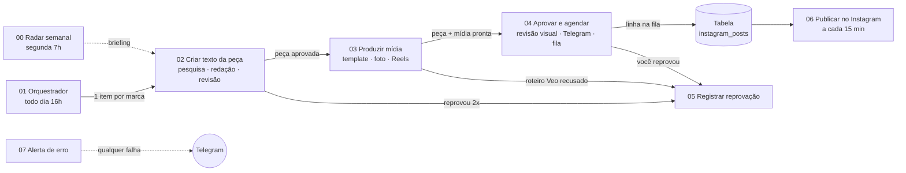

# Instagram automático: Tábua, Puka e ezf.tech (n8n)

O fluxo antigo era **um workflow de 70 nós**. Agora são **7 workflows pequenos**, cada um com uma função, uma nota de cabeçalho dizendo *o que faz / o que entra / o que sai*, e faixas coloridas separando as fases. A lógica dos nós é a mesma; o que mudou é a organização e como os dados passam de um para o outro.

> **Estado:** os JSON foram gerados a partir do fluxo original e conferidos por script (conexões, referências entre nós, sintaxe dos nós de código), mas **ainda não foram importados numa instância n8n real**. Veja "Primeira importação" abaixo.

## O mapa



| # | Workflow | Quando roda | Entra | Sai |
|---|---|---|---|---|
| 00 | **Radar semanal** | segunda 7h | alvos por marca | briefing em `instagram_referencias` |
| 01 | **Orquestrador** | todo dia 16h (ou botão de teste) | relógio | 1 item por marca → 02 |
| 02 | **Criar texto da peça** | chamado pelo 01 | marca, tipo (feed/reel), motor, pilar | **peça aprovada** → 03 |
| 03 | **Produzir mídia** | chamado pelo 02 | a peça | peça + mídia hospedada → 04 |
| 04 | **Aprovar e agendar** | chamado pelo 03 | peça com mídia | linha `agendado` na fila |
| 05 | **Registrar reprovação** | chamado por 02, 03 e 04 | registro da reprovação | linha `reprovado` + aviso |
| 06 | **Publicar no Instagram** | a cada 15 min | fila | post publicado + aviso |
| 07 | **Alerta de erro** | quando outro falha | erro do n8n | aviso no Telegram |

Cada etapa chama a próxima **sem esperar** o fim dela. Assim uma falha ou uma espera (por exemplo, sua aprovação no Telegram) não trava as outras, e cada execução fica curta e fácil de achar na lista de execuções.

## A "peça": o objeto que viaja entre 02, 03 e 04

No fluxo antigo, os nós do fim buscavam dados nos nós do começo (`$('Consolidar post aprovado')`). Isso não funciona entre workflows, então agora tudo vai **dentro de um único objeto**, criado no fim do 02 (nó *Consolidar post aprovado*):

`marca` (objeto com nome, regras, `geral`…) · `tipo` · `motor` · `rota` · `modelo` · `pilar` · `tema` · `legenda` · `alt_text` · `dados_render` · `dados_render_json` · `prompt_imagem` · `prompt_veo` · `cenas_texto` · `fontes_usadas` · `nota_revisao` · `observacoes_revisao` · `reescrito` · `veo_no_mes` · `arquivo` · `pasta` · `midia_url`

O 03 acrescenta `veo_gerado` e `veo_ok` (o que aconteceu com o Veo). O 04 grava na fila e o 06 só lê a tabela.

Reprovação: quem reprova monta um registro com `marca, nome_marca, telegram_chat_id, tipo, modelo, motor, pilar, tema, legenda, midia_url, nota_revisao, status, erro` e chama o 05, que grava e avisa. A regra existe uma vez só.

## Primeira importação (nesta ordem)

1. **Tabelas (Data Tables):** `instagram_posts` (marca, tipo, modelo, motor, pilar, tema, legenda, midia_url, **midia_urls**, fontes, status, ig_user_id, ig_media_id, erro, nota_revisao, agendado_para; `midia_urls` guarda a lista de lâminas do carrossel em JSON) e `instagram_referencias` (marca, semana, briefing, erros, urls_validas, posts_analisados).
2. **Importe os workflows de trás para frente:** 07, 06, 05, 04, 03, 02, 01 (e o 00 quando quiser o radar). Assim cada "Chamar ..." já encontra o destino.
3. **Ligue os "Chamar":** em cada nó **Chamar 0X · ...** (laranja, com nota) escolha o workflow de destino na lista. Estão com `PREENCHER_ID_...`.
   - 01 → chama o 02 · 02 → chama 03 e 05 · 03 → chama 04 e 05 · 04 → chama 05.
4. **Configuração única:** no workflow **01**, nó **Marcas e regras**, troque os `PREENCHER` (chat do Telegram, bucket, URL pública, URL do render, IDs do Instagram). No **06**, troque o chat em **Avisar resultado**. No **07**, o chat do alerta.
5. **Credenciais:** Gemini texto (também faz a busca na web do 02 e do 00) · Gemini imagem/vídeo · Telegram · S3/R2 · Header Auth do render (`Authorization: Bearer …`) · Meta Graph API.
6. **Fuso:** cada workflow → Configurações → **America/Sao_Paulo**.
7. **Error workflow:** em cada workflow de 01 a 06 → Configurações → **Error workflow** → *07 · Alerta de erro*.
8. **Teste:** no 01, rode **Testar feed (todas as marcas)** e acompanhe a peça passando pelos workflows na lista de execuções. Ative o 06 por último.

## Como o redator e o render conversam

1. No 02, o nó **Catálogo de modelos (render)** pergunta ao serviço (`GET /modelos?marca=…&formato=feed&automatico=1`) quais modelos a marca tem e o que cada um aceita.
2. **Montar instruções de feed** transforma esse catálogo em instruções para o redator: ele escolhe **um modelo** e preenche **`modelo` + `textos`** respeitando os limites de caracteres.
3. **Consolidar post aprovado** confere se o modelo existe e monta `{marca, modelo, textos}`; o 03 manda isso para `POST /render?binario=1` e recebe o JPG.

Quando você cria um modelo novo no render, ele aparece para o redator sozinho, sem mexer no n8n. Modelos de conteúdo fixo (como o do cliente Aqua Fit, da ezf) ficam de fora da escolha automática. Modelos com foto real não estão no catálogo, então a rota "feed-foto" (Nano Banana) fica dormente.

A credencial do render é **Header Auth** com Name `Authorization` e Value `Bearer <RENDER_TOKEN>`.

## Radar → redator

No 02, o nó **Briefing do radar (semana)** lê a última linha de `instagram_referencias` da marca. **Escolher pilar e pesquisa** monta um texto com resumo, padrões, ganchos, lacunas e até 5 ideias do formato da peça (carrossel, feed ou Reels), só se o briefing tiver até 10 dias. O redator e o reescritor recebem esse texto como inspiração de ângulo; o revisor reprova cópia de texto ou gancho e qualquer coisa do radar tratada como fato da marca. Sem briefing recente, a peça sai normalmente, sem radar. Os modelos sugeridos pelo radar (00) agora usam os nomes reais do render.

## Carrossel (de ponta a ponta)

| Etapa | O que acontece |
|---|---|
| 01 | Cada marca tem `carrossel_dia` e `carrossel_a_cada_semanas` em **Marcas e regras**. Hoje: Puka quarta, Tábua e ezf quinta, toda semana, no lugar do feed daquele dia. Botão de teste: **Testar carrossel**. |
| 02 | O catálogo vem filtrado por `formato=carrossel`; o redator escolhe um modelo de várias lâminas e escreve `textos`. |
| 03 | A rota `carrossel` chama `POST /render`, baixa cada lâmina do render, hospeda uma a uma no S3/R2 e junta as URLs em `midia_urls`. |
| 04 | A prévia no Telegram mostra a capa e lista todas as lâminas. Na fila, `midia_urls` guarda a lista. |
| 06 | Cria um contêiner por lâmina (`is_carousel_item`), espera, cria o contêiner do carrossel (`media_type=CAROUSEL`, `children`, legenda) e segue o mesmo caminho de status e publicação. |

O carrossel usa o mesmo horário de feed da marca. Para mudar a frequência, edite os dois campos acima. A Meta aceita de 2 a 10 imagens por carrossel; o fluxo recusa fora disso.

## Reels

O render faz **Reels animado da ezf** (rota `/reel`, com trilha original). Tábua e Puka ainda não têm Reels (`reels_disponivel: false` em "Marcas e regras"), e o Veo está desligado (`veo_limite_mes: 0`) até o render montar o clipe do Veo.

## O que ainda não está alinhado (próximo passo)


## Arquivos

```
n8n/
  README.md                       este mapa
  fluxo/
    00-radar-semanal.json  (.md)  radar de concorrentes e tendências
    01-orquestrador.json
    02-criar-texto-da-peca.json
    03-produzir-midia.json
    04-aprovar-e-agendar.json
    05-registrar-reprovacao.json
    06-publicar-no-instagram.json
    07-alerta-de-erro.json
  referencias-tabua.md            referências de conteúdo da Tábua
```
